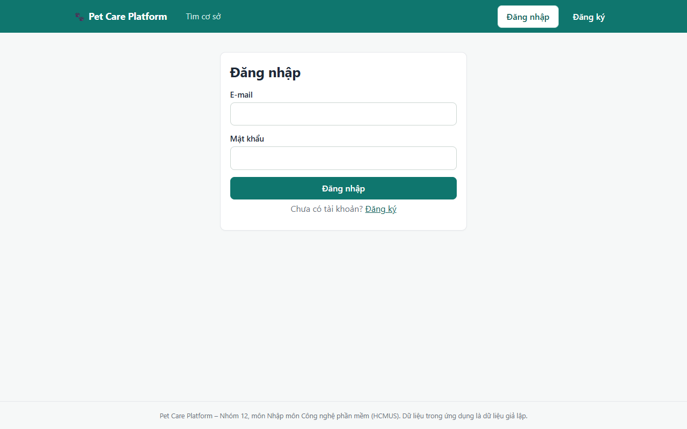
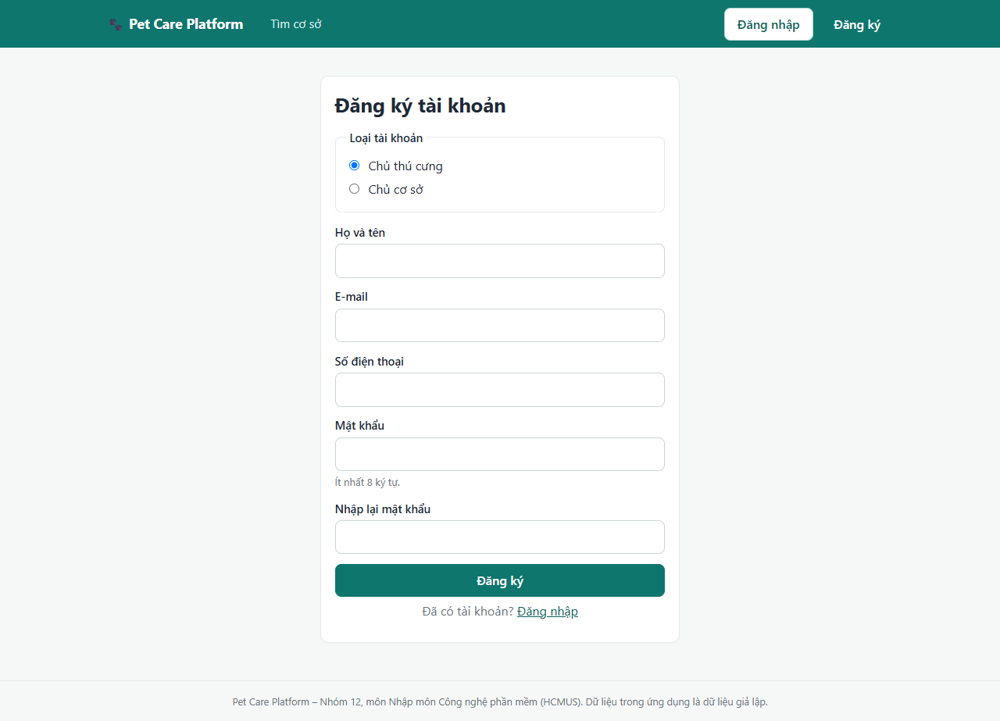
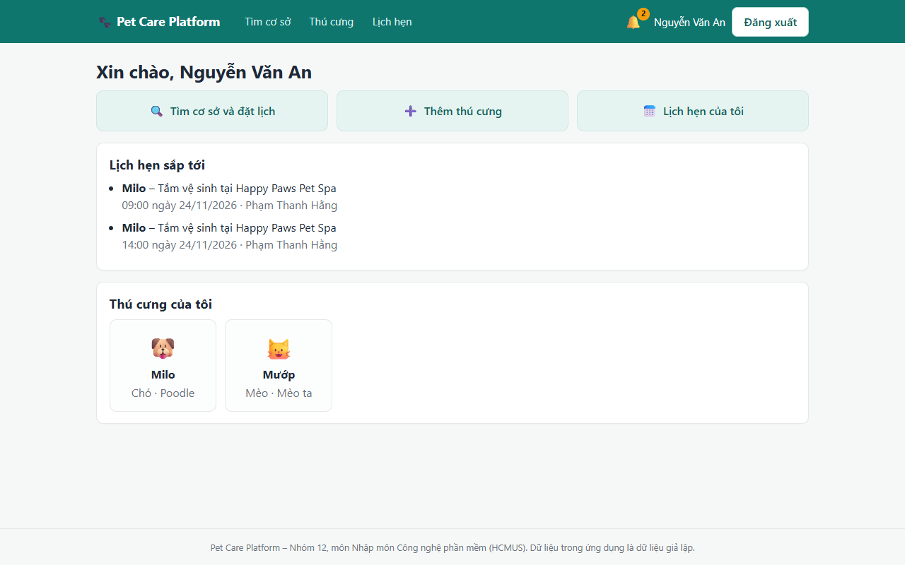
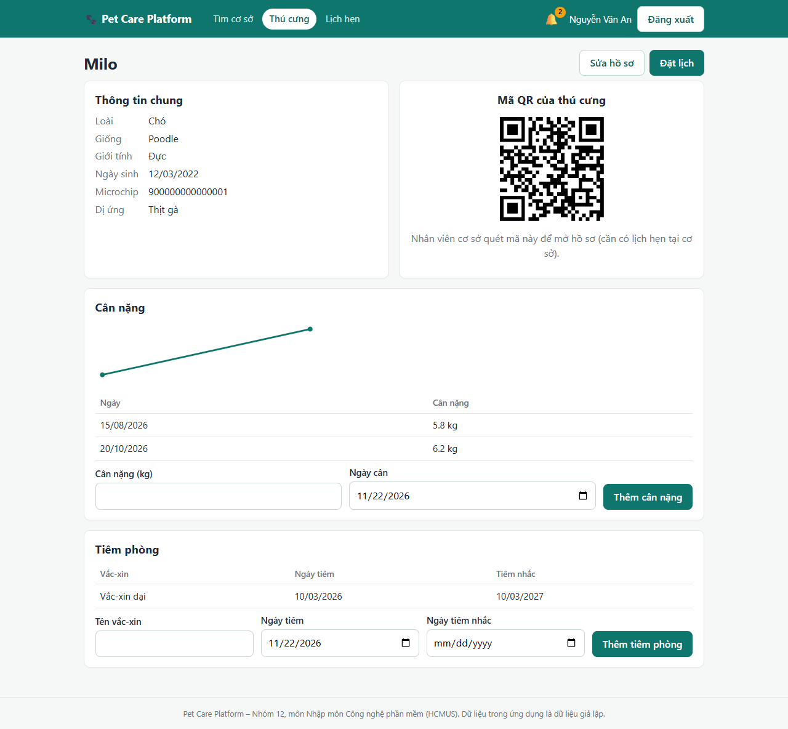

# Pet Care Platform PA4 screen descriptions

Group 12 · Build 0.4.0 · Commit `5777ca3`

## 1. Sign in

**Purpose.** Let a registered user start a session and reach the area for their role.

**Displayed information.** The form shows email and password fields, a sign-in button and a link to registration. Validation or sign-in feedback appears when applicable.

**How to use.** Enter the email and password and select **Đăng nhập**. A pet owner reaches the owner home page. A facility owner is directed to the facility bookings page.

## 2. Register

**Purpose.** Let a visitor create a pet owner or facility owner account.

**Displayed information.** The form shows the account type, full name, email, phone number, password and password confirmation.

**How to use.** Choose an account type, complete the form and submit it. Correct the highlighted fields if validation fails. Successful registration opens the sign-in screen with a confirmation message.

## 3. Pet owner home

**Purpose.** Give the signed-in owner access to common tasks and a summary of their pets and bookings.

**Displayed information.** The page shows a greeting, shortcuts, upcoming appointments and a list of the owner's pets.

**How to use.** Select a shortcut to find a facility, add a pet or open bookings. Select a pet from the list to view its profile.

## 4. Pet profile

**Purpose.** Let the owner review and maintain a pet's profile and health records.

**Displayed information.** The page shows the pet's basic information, allergies, QR image, weight history and vaccination records. A chart appears once the pet has multiple weight entries.

**How to use.** Open a pet from **Thú cưng của tôi**. Use **Sửa hồ sơ** to change its information, or complete the weight or vaccination form to add a record. The pet list provides the archive action and asks for confirmation.
