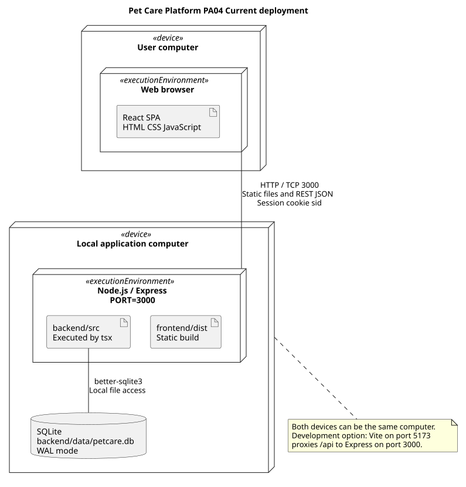
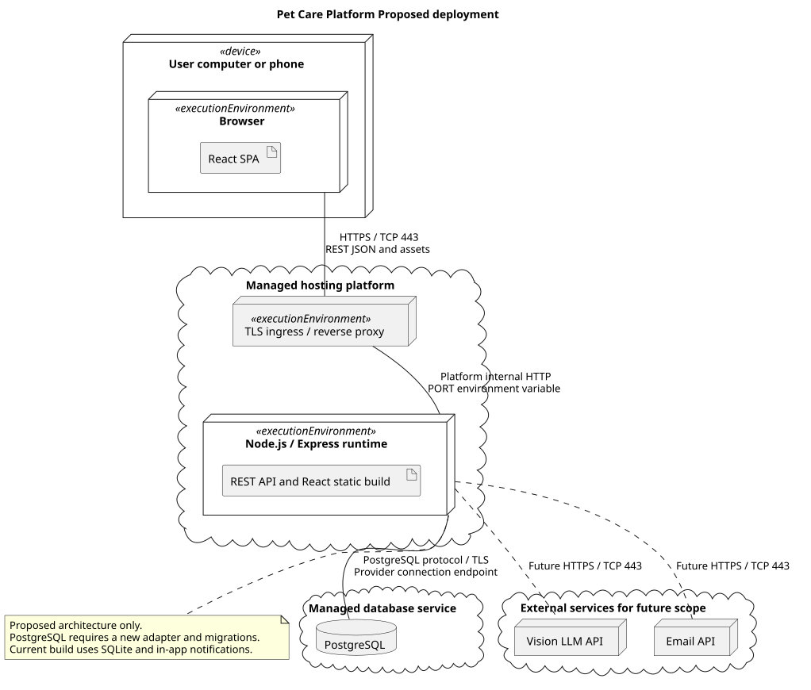

# SAD mục 5 và 6 của Pet Care Platform

Bản bàn giao riêng của Nguyễn Minh Quân cho mục 5 và 6 của SAD PA04, dựa trên mã nguồn hiện có ngày 22/11/2026. Kiến trúc chạy hiện tại dùng React, Express và SQLite. Phương án PostgreSQL là đích thiết kế, cần thay đổi lớp truy cập dữ liệu trước khi triển khai.

Bản nền tham chiếu là SAD v1.0 (revision 09/11/2026, Group 12), để trống mục 5–6 cho PA04. Các mục dưới đây mô tả Deployment View và Implementation View của PA04; không thay thế bản SAD tổng hợp. Đề xuất đồng bộ mục 1–4 được cung cấp riêng tại [SAD_PA04_Alignment.md](SAD_PA04_Alignment.md).

## 5 Deployment View

### 5.1 Bản chạy PA04

Sơ đồ UML: [nguồn PlantUML](diagrams/deployment-current.puml) và [ảnh SVG](diagrams/deployment-current.svg).



| Node | Trách nhiệm và artifact | Giao tiếp |
|---|---|---|
| Máy người dùng và trình duyệt | Hiển thị React SPA; nhập dữ liệu, xem kết quả và gửi yêu cầu. Có thể cùng máy với máy chủ khi demo localhost. | HTTP tới Express cổng 3000; API dùng REST/JSON, phiên dùng cookie `sid`. |
| Môi trường Node.js chạy Express | `backend/src/server.ts` mở CSDL và chạy máy chủ; `app.ts` ghép middleware, controller và service. `tsx` thực thi TypeScript. Express phục vụ cả `frontend/dist` và `/api`. | HTTP trên `PORT` (mặc định 3000); truy cập SQLite bằng thư viện `better-sqlite3` trong tiến trình. |
| Tệp SQLite trên máy ứng dụng | Lưu tài khoản, phiên, thú cưng, cơ sở, dịch vụ, nhân viên, ca làm, booking và thông báo. Mặc định `backend/data/petcare.db`; WAL và foreign keys được bật khi mở. | Truy cập tệp cục bộ; không có máy chủ CSDL hay cổng mạng PostgreSQL trong bản này. |

Ở chế độ phát triển, Vite phục vụ giao diện ở cổng 5173 và proxy `/api` tới cổng 3000. Đây là biến thể phát triển, không phải cấu hình cần để chạy bản build đã kèm repo.

Các module Identity, Pet, Facility, Booking và Notification chạy trong cùng một tiến trình ứng dụng, phân lớp Controller → Service → Repository. Các lời gọi giữa module là lời gọi hàm trong tiến trình, không phải các microservice độc lập.

Booking dùng giao dịch SQLite `IMMEDIATE` để kiểm tra chồng lấn và ghi lịch. Chỉ mục duy nhất chặn hai lịch đang hoạt động của cùng nhân viên tại cùng thời điểm bắt đầu; kiểm tra chồng lấn khoảng thời gian nằm trong service/repository. Thời điểm lưu dạng ISO UTC; ngày và giờ nghiệp vụ theo UTC+7.

### 5.2 Phương án triển khai dự kiến

Sơ đồ UML: [nguồn PlantUML](diagrams/deployment-target.puml) và [ảnh SVG](diagrams/deployment-target.svg).

SAD v1.0 mục 2.2 chưa cố định nhà cung cấp hosting, LLM hoặc email. Sơ đồ đích dùng các node hosting và CSDL được quản lý, độc lập nhà cung cấp; Render/Neon trong phiếu PA3 là các ví dụ đề xuất. Prisma thuộc thiết kế PA03, chưa được cài hoặc sử dụng trong bản code PA04 này.



| Node | Trách nhiệm | Giao tiếp |
|---|---|---|
| Trình duyệt trên máy tính hoặc điện thoại | Chạy React SPA, truy cập ứng dụng responsive. | HTTPS cổng 443 tới hosting. |
| TLS ingress của hosting | Nhận kết nối HTTPS và chuyển tiếp tới ứng dụng. | HTTP nội bộ của nền tảng tới cổng `PORT`. |
| Môi trường ứng dụng Node.js | Chạy Express API và cung cấp bản build React; kiểm tra phiên, quyền và nghiệp vụ. | PostgreSQL qua TLS; các API ngoài qua HTTPS nếu được triển khai. |
| PostgreSQL được quản lý | Lưu dữ liệu tập trung và bảo đảm giao dịch. | Endpoint và thông số TLS do nhà cung cấp cấp. |
| Vision LLM API và Email API | Phục vụ trích xuất sổ tiêm và gửi email trong phạm vi phát triển sau. | HTTPS 443; chưa tích hợp trong bản PA04 hiện tại. |

Để thực thi phương án này, cần thay adapter `better-sqlite3`, chuyển schema và truy vấn sang PostgreSQL, bổ sung migration/seed, cấu hình kết nối và kiểm thử giao dịch chống đặt trùng. Việc đổi biến môi trường không tự chuyển được CSDL. Với nhiều tiến trình ứng dụng, phải bảo đảm quy tắc chồng lấn lịch bằng cơ chế giao dịch/khóa hoặc ràng buộc phù hợp trên PostgreSQL.

Khi chạy sau proxy HTTPS, cần kiểm tra cấu hình proxy, secure cookie và lưu phiên với môi trường thật. Bản PA04 hiện tại chỉ tạo thông báo trong ứng dụng; email, AI, lịch lưu trú và dịch vụ nhắc lịch nền thuộc phạm vi phát triển sau. Yêu cầu nền đếm thông báo xác thực phiên nhưng không gia hạn thời điểm hoạt động; mở trang thông báo vẫn cập nhật hoạt động theo bản sửa UC02 trên nhánh hiện tại.

### 5.3 Cấu hình và vận hành bản hiện tại

| Cấu hình | Mặc định | Ý nghĩa |
|---|---|---|
| `PORT` | `3000` | Cổng Express |
| `DB_FILE` | `backend/data/petcare.db` | Tệp SQLite; kiểm thử dùng CSDL riêng hoặc trong bộ nhớ |
| `FRONTEND_DIST` | `frontend/dist` | Thư mục build React |
| `SESSION_IDLE_SECONDS` | `1800` | Hết phiên sau 30 phút không hoạt động |
| `MAX_FAILED_LOGINS`, `LOCK_MINUTES` | `5`, `15` | Khóa tạm sau đăng nhập sai |
| `CANCEL_LIMIT_HOURS` | `2` | Giới hạn hủy lịch trực tuyến |
| `NODE_ENV` | Theo môi trường | `production` bật thuộc tính secure cho cookie |

Chạy theo `README.md`: cài dependency backend và `npm start`; mở `http://localhost:3000`. Nếu thay giao diện, cài dependency frontend và `npm run build` để cập nhật `frontend/dist`. Lần khởi động đầu tạo schema và dữ liệu mẫu. Dữ liệu demo là giả lập. Khi sao lưu SQLite đang chạy cần dùng cơ chế sao lưu SQLite phù hợp với WAL, hoặc dừng ứng dụng rồi sao lưu nhất quán.

## 6 Implementation View

### 6.1 Cấu trúc thư mục

```text
petcare-platform/
├── backend/
│   ├── src/
│   │   ├── server.ts             # Điểm khởi động
│   │   ├── app.ts                # Ghép ứng dụng và route
│   │   ├── config.ts             # Cấu hình môi trường
│   │   ├── common/               # API, lỗi, middleware xác thực, thời gian
│   │   ├── db/                   # Schema, kết nối SQLite, seed
│   │   └── modules/
│   │       ├── identity/         # Tài khoản và phiên
│   │       ├── pet/              # Hồ sơ, cân nặng, tiêm phòng, QR
│   │       ├── facility/         # Tra cứu cơ sở, dịch vụ, nhân viên, ca làm
│   │       ├── booking/          # Giờ trống và vòng đời lịch hẹn
│   │       └── notification/     # Thông báo trong ứng dụng
│   ├── tests/api.test.ts         # Kiểm thử API
│   ├── package.json
│   └── package-lock.json
├── frontend/
│   ├── src/
│   │   ├── App.tsx               # Route và kiểm tra vai trò
│   │   ├── api.ts                # HTTP client và kiểu dữ liệu
│   │   ├── auth.tsx              # Trạng thái đăng nhập
│   │   ├── format.ts             # Định dạng hiển thị
│   │   ├── components/           # Layout và UI dùng chung
│   │   ├── pages/                # Auth, Pet, Facility, Booking, Home
│   │   ├── main.tsx
│   │   └── styles.css
│   ├── dist/                     # Giao diện đã build, có trong repo
│   ├── vite.config.ts            # Dev server và API proxy
│   └── package.json              # Có package-lock.json và tsconfig
├── e2e/
│   ├── tests/                    # UC02, UC03, UC07, helpers và chụp UI
│   ├── playwright.config.ts      # Trình duyệt, máy chủ và dữ liệu test riêng
│   └── package.json              # Có package-lock.json và tsconfig
├── docs/
│   ├── test/                     # Excel test cases và hướng dẫn chạy tay
│   └── quan/                     # SAD 5–6, prototype, kế hoạch và review F4
├── .github/ISSUE_TEMPLATE/        # Mẫu báo lỗi
├── .gitignore
├── package.json                  # Lệnh hỗ trợ ở thư mục gốc
├── README.md                     # Cài đặt, chạy và tài khoản demo
└── old PAs/                      # Tài liệu tham chiếu cũ có trên máy làm việc
```

`old PAs/` là tài liệu tham chiếu đang có tại workspace, không phải dependency chạy ứng dụng. `node_modules/`, `backend/data/`, `e2e/.tmp/`, `e2e/results/` và log là dữ liệu phát sinh được bỏ qua trong Git.

### 6.2 Ánh xạ thành phần sang mã nguồn

| Thành phần | Tệp hoặc thư mục chính | Trách nhiệm |
|---|---|---|
| Web UI | `frontend/src/pages`, `components`, `App.tsx` | Hiển thị và điều hướng theo vai trò |
| Identity and Access | `backend/src/modules/identity`, `common/authMiddleware.ts` | Xác thực, phiên, phân quyền |
| Pet Profile | `backend/src/modules/pet` | Hồ sơ, QR, cân nặng và tiêm phòng |
| Facility and Catalog | `backend/src/modules/facility` | Dữ liệu cơ sở và danh mục cho tra cứu/đặt lịch |
| Booking and Availability | `backend/src/modules/booking` | UC07–09, UC11; UC06 được hiện thực ở module facility |
| Reminder and Notification | `backend/src/modules/notification` | Phần đã có: thông báo trong ứng dụng |
| Data | `backend/src/db`, các repository | Schema, seed và truy cập dữ liệu |

Các thành phần AI, Review/Administration và đầy đủ Reminder là phạm vi thiết kế/phát triển tiếp, chưa có module thực thi tương ứng trong bản hiện tại. Mục 4 của SAD cần thống nhất phân biệt thành phần dự kiến với hiện thực.

### 6.3 Các tệp hỗ trợ và kiểm chứng

`package-lock.json` cố định bộ dependency cho từng phần; `tsconfig.json` điều khiển kiểm tra TypeScript. `e2e/playwright.config.ts` khởi động hai backend ở 3100 và 3101 với SQLite riêng; máy thứ hai rút thời gian phiên để kiểm tra hết hạn. Bộ ảnh UI dùng project `screens`. Kiểm thử API dùng clock cố định và CSDL trong bộ nhớ, không sửa dữ liệu demo.

Các lệnh chính: backend `npm test`, `npm run typecheck`; frontend `npm run build`; e2e `npx playwright test --project=chromium`, `--project=edge`, `--project=mobile-360`, và `--project=screens`. Kết quả thực chạy của đợt thực hiện phần Quân được ghi tại `F4_REVIEW.md`, không suy ra từ mô tả README.
